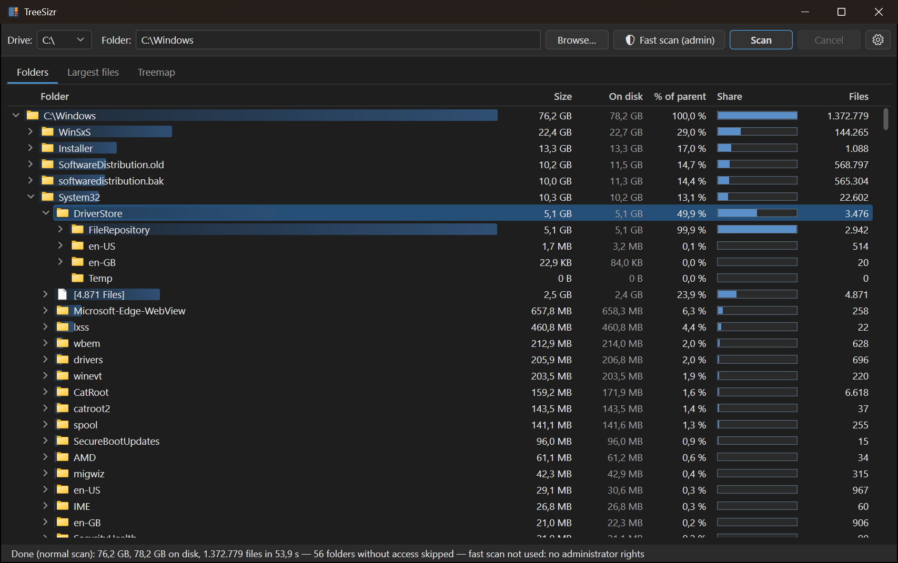
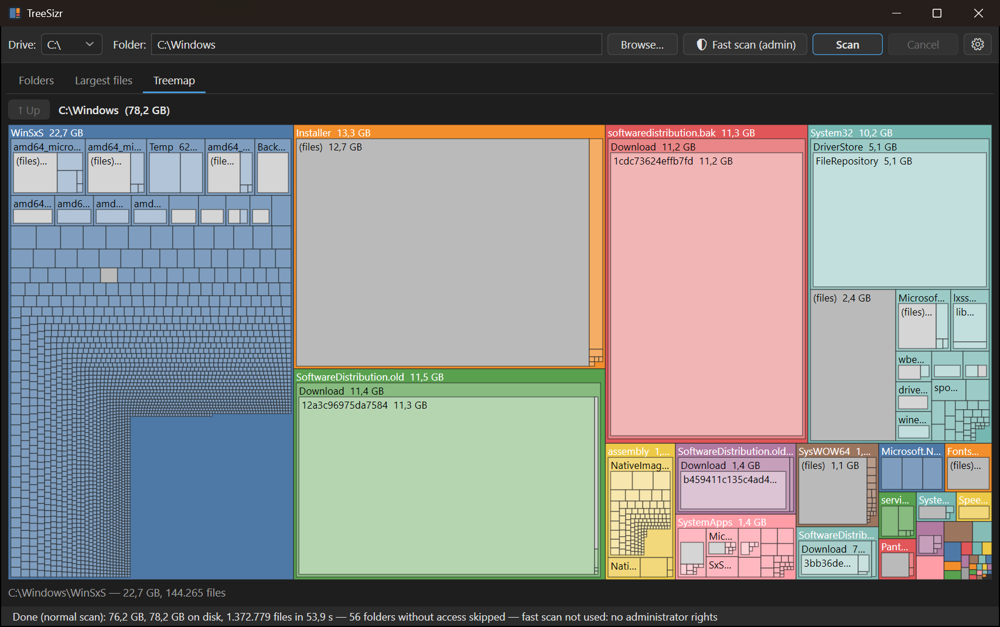

# TreeSizr

A fast disk space analyzer for Windows, in the spirit of TreeSize and WizTree.
Pick a drive or folder and TreeSizr shows where your disk space went: a sortable folder tree,
the largest files and a treemap.

- **Free and open source** – MIT licensed. No paid "Pro" version, no features held back.
- **No ads, no nagging** – no pop-ups, no upgrade reminders, no account to create.
- **Private** – TreeSizr never connects to the internet. No telemetry, nothing is uploaded;
  it only reads your disk and saves its own settings.
- **Fast** – a full system drive with millions of files in about 5 seconds with the fast scan.
- **Simple** – one `.exe`, nothing to install. Start it, pick a drive, click Scan.

<p>
  
  
</p>

## Download

Get `TreeSizr.exe` from the [latest release](../../releases/latest). It is a single, self-contained
file: no installer and no .NET runtime needed. Windows 10 or 11, 64-bit.

## Features

- **Folder tree** sorted by size, with per folder: size, size on disk, % of the parent folder,
  a share bar and the number of files. A size bar behind each name shows its share at a glance.
  The files in a folder appear in the tree too, grouped as "[N Files]" next to its subfolders.
- **Two scan engines**
  - **Fast MFT scan** – when running as administrator on a local NTFS drive, TreeSizr reads the
    NTFS Master File Table directly. A full system drive with ~4.4 million files takes about 5 seconds.
  - **Normal scan** – works on any drive (NTFS, exFAT, FAT32, network) without admin rights.
    Folders are scanned in parallel; folders you have no access to are skipped and marked.
- **Size and size on disk** – "On disk" shows the space actually used, so OneDrive online-only files,
  sparse files (VM and emulator disks) and compressed files no longer inflate the total.
  The MFT scan also counts hard links only once, so its total matches what Windows reports as used.
  By default the tree order, percentages, bars, treemap and largest files follow the space on disk;
  the settings can switch them to the file size.
- **Largest files** – the 50 largest files (configurable up to 1000).
- **Treemap** – squarified treemap of the selected folder; click a block to zoom in.
- **Context menu** – open in Explorer, show file in Explorer, copy path.
- **Light and dark theme** – follows the Windows app mode by default, or pick one in the settings.
- **Settings** – language, theme, sort by size or on disk, name bar style (gradient / solid / off), size in front of names,
  optional columns, number of largest files, MFT scan on/off. Stored in `%APPDATA%\TreeSizr\settings.json`.
- **Languages** – English (default) and Dutch, switchable at runtime.

### Fast scan

The MFT scan needs administrator rights. Click **🛡 Fast scan (admin)** in the toolbar to restart
TreeSizr elevated, or start it from an elevated terminal. Without admin rights, or on non-NTFS drives,
TreeSizr automatically uses the normal scan; the status bar tells you why.

## How sizes are counted

| | Size | On disk |
|---|---|---|
| Normal file | file length | allocated clusters |
| OneDrive online-only | full file length | 0 |
| Sparse / compressed | full file length | clusters really in use |
| Hard links | every link counts | MFT scan: once · normal scan: every link |

Junctions and symbolic links are not followed, to avoid loops and double counting.

## Building

Requires the [.NET 10 SDK](https://dotnet.microsoft.com/download/dotnet/10.0).

```bash
dotnet run --project src/TreeSizr
```

```bash
dotnet test
```

To build the single-file `.exe` yourself:

```bash
dotnet publish src/TreeSizr -c Release -r win-x64 --self-contained -p:PublishSingleFile=true -p:EnableCompressionInSingleFile=true -o publish
```

A new release is built by GitHub Actions when a version tag such as `v0.2.0` is pushed.

## Project layout

| Path | What it does |
|---|---|
| `src/TreeSizr/Scanning/DiskScanner.cs` | Normal scan: parallel directory enumeration |
| `src/TreeSizr/Scanning/MftScanner.cs` | Fast scan: reads and parses the NTFS MFT |
| `src/TreeSizr/Scanning/DirNode.cs` | The scanned tree and size aggregation |
| `src/TreeSizr/ViewModels/` | Main window state and the rows of the folder tree |
| `src/TreeSizr/Controls/TreemapControl.cs` | Squarified treemap rendering |
| `src/TreeSizr/Themes/` | Light and dark colors, and the control styles that use them |
| `src/TreeSizr/Resources/Strings*.resx` | All UI texts, per language |
| `tests/TreeSizr.Tests/` | Unit tests, including the MFT parser |

## Adding a language

Copy `src/TreeSizr/Resources/Strings.nl.resx` to `Strings.xx.resx` (with `xx` the language code), translate
the values, and add the language to `Loc.Languages` in `Loc.cs`; it then appears in the settings window.
A test checks that every translation has all texts and placeholders.

## License

[MIT](LICENSE)

TreeSizr is an independent project. It is not affiliated with or endorsed by JAM Software, the maker of TreeSize.
